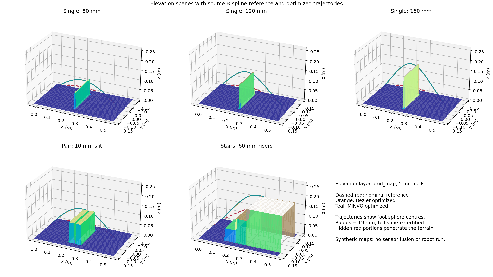
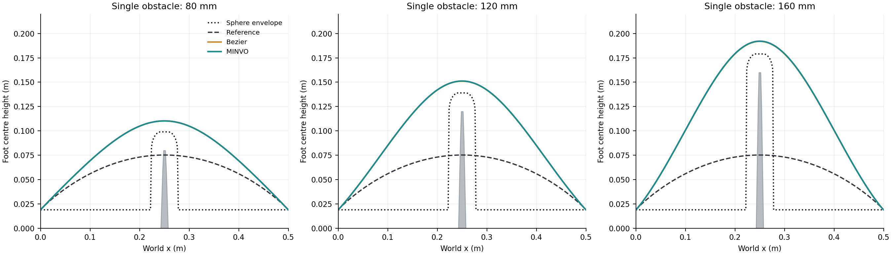
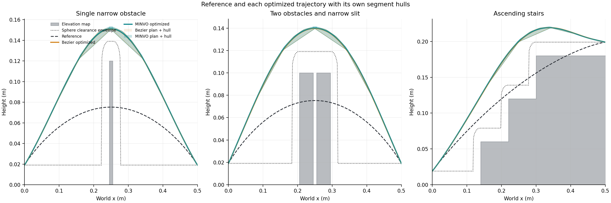
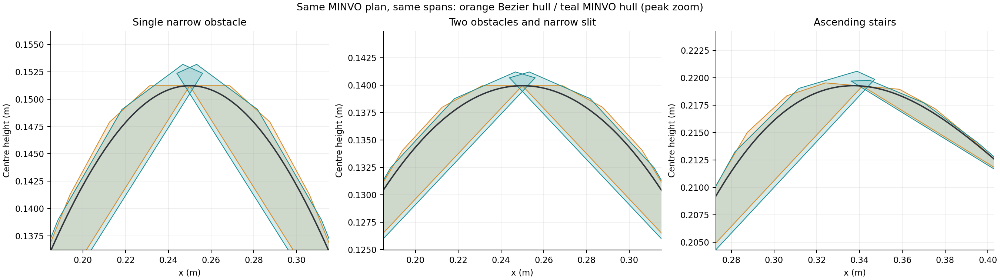

# 高程图场景：单障碍、连续双障碍和楼梯

> MINVO 测试现已迁入[独立 minvo_test 包](../../../test/src/minvo_test/README.md)，新的配置、源码路径和启动命令见该 README。以下保留本轮次的历史实验记录。


本实验生成与 elevation_mapping 输出相同数据类型的 `grid_map::GridMap`，层名 `elevation`、坐标系 `odom`、分辨率 5 mm，并直接传给生产 `GridMapTerrainInterface`。它是确定性合成地图，不经过点云融合；没有启动 Gazebo、elevation_mapping 传感器管线或机器人。可在静态图中查看，也可发布标准 `grid_map_msgs/GridMap` 在 RViz 中查看。

## 实现来源

数据生成器：[minvo_elevation_scenarios.cpp](../../../test/src/minvo_elevation_scenarios.cpp)。直接链接控制器库并调用：

- 生产 `BSpline` 构建参考、计算轨迹位置；没有使用 `test/src/BSpline.cpp`、SciPy 或 Python 拟合替代品。
- 生产 `SwingTrajectoryQpOptimizer`，同一参考分别启用 Bézier/MINVO 高度约束。
- 生产 `SwingCollisionCertifier` 进行 §3.3 参考/输出认证。
- 生产 `extractPolynomialSegments` / `hullMap` 导出每条优化曲线的两种凸包顶点。Python 只将顶点按二维凸包排序绘图，没有重新计算基变换。
- 生产 `GridMapTerrainInterface::getSphereClearanceUpperBound` 导出足端球体所需球心高度包络，并独立密集测量优化结果净空。

沿用上一轮工程方式：新增一个测试/可视化入口，不修改在线规划器；无新算法库依赖。ROS 发布使用已安装的 `grid_map_ros`、`rclcpp` 和 `visualization_msgs`。

## 场景设计

地图大小为 1.0×0.3 m，中心 `(0.25,0)`。障碍在 y∈[−0.10,0.10] 内占据，每个场景独立。

| 标识 | 地形 | 目的 |
|---|---|---|
| `single_low` | x∈[0.245,0.255]，高 80 mm | 窄障碍低高度对照 |
| `single` | 同位置、宽 10 mm，高 120 mm | 与前一轮 narrow_obstacle 类似的漏碰参考和抬脚修正 |
| `single_high` | 同位置、宽 10 mm，高 160 mm | 更高障碍的修正量变化 |
| `pair` | 两块 x∈[0.205,0.245] 与 [0.255,0.295]，各高 100 mm | 10 mm 狭缝，小于足端球体直径 38 mm |
| `stairs` | x=0.14/0.22/0.30 处依次升到 60/120/180 mm | 原上楼参考穿入阶梯，优化后到顶层平台 |

高度字段实际存为 GridMap 的 float；落脚接触高度直接通过地形接口读取，避免独立 double 常量与存储值在硬端点等式处不一致。栅格和双线性插值是本实验实际认证的地图模型，不把图中理想立面当成额外认证对象。

两种优化均使用五次样条 15 控制点、60 个目标样点、每个原始段细分 4 份、净空间隙峰值 10 mm、足端半径 19 mm、同样目标权重与求解预算 200。固定 XY、0.4 s 摆时及首末 p/v/a；不加采样 IK 工作空间，因而本实验只检验参考几何避障，不代表动力学或实机可行性。

## 高程图与轨迹

三维图叠加参考和两条优化曲线；曲线高度均是**球心高度**。Bézier 与 MINVO 结果非常接近，部分线条重叠。与前一轮以“球心高度减半径”为纵轴的图相比，此处整体加了 19 mm。





[二维高程俯视图](minvo_elevation_scenarios_2026-11-11/elevation_scenarios.png)显示了原始栅格。由于固定 XY，参考与两条优化曲线的俯视投影重叠，抬脚差别需要看三维或侧视图。

## 各自轨迹与包络

橙色是 Bézier 优化轨迹及其 Bézier 凸包；青色是 MINVO 优化轨迹及其 MINVO 凸包。两组都使用原始非零多项式段绘制，未通过改变绘图细分粒度制造差异。曲线与凸包是参考中心几何；点线是由生产地形接口计算的足端球体所需球心高度，凸包本身没有在图中再次膨胀半径。

**图中包络为原始段包络，用于观察基变换；QP 实际使用每段细分 4 份的约束，认证器还可递归细分。原始包络与障碍投影重叠并不表示输出不安全。**



还导出了同一 MINVO 优化轨迹、同一原始分段下的两类包络，排除“曲线本身不同”对紧致性比较的干扰：



不能从这些图得出 MINVO 普遍更紧。本组曲线的分段 XZ 投影凸包面积之和中，MINVO 比 Bézier 反而大约 20.8%–21.4%（见[包络指标](minvo_elevation_scenarios_2026-11-11/envelope_metrics.csv)）。这是二维投影面积之和，不是三维体积、并集面积或 QP 可行域大小；当前轨迹 y 恒为零，直接比较三维体积会得到两边都为零，没有意义。

这与上一轮特定一维二次曲线的“MINVO 下界更紧”可以同时成立：体积目标、投影面积和某一方向的高度下界并非同一指标。这里如实保留不利结果，不强制画出算法并未产生的优势。

## 避障与狭缝结果

全部 5 个场景的参考均出现实际地形穿透，生产参考认证返回 `CollisionDetected`；10 条优化输出全部通过生产连续认证。

| 场景 | 参考最低曲线高度减地形 | 优化后球体最小净空 | 认证 |
|---|---:|---:|---|
| 单障碍 80 mm | −23.753 mm | 0 mm | 两模式通过 |
| 单障碍 120 mm | −63.753 mm | 0 mm | 两模式通过 |
| 单障碍 160 mm | −103.753 mm | 0 mm | 两模式通过 |
| 连续双障碍 | −45.251 mm | 0 mm | 两模式通过 |
| 楼梯 | −42.204 mm | 0 mm | 两模式通过 |

优化后最小净空包含允许接触的起终点，因此是 0。参考穿透指标采用“球心高度−半径−地形高度”，是直接的拒绝见证；输出净空指标考虑整个足端球体与邻近占据柱，不只比较脚下地形。

双障碍狭缝 x∈[0.245,0.255] 中，Bézier 输出的最小球底高度为 **120.671 mm**，MINVO 为 **120.912 mm**；两者都高于 100 mm 障碍顶面，没有下探进狭缝。生成器内对这一条件和球体密集净空均有失败断言，连续安全接受仍以 §3.3 认证为准。这证明本场景的结果，不能推广成所有障碍布局下都不下探的通用定理。

完整指标：[scene_metrics.csv](minvo_elevation_scenarios_2026-11-11/scene_metrics.csv)。其中证书枚举 0=`ProvenSafe`。地图、轨迹、两种基的原始凸包顶点分别位于同目录的 `elevation_map.csv`、`scene_trajectories.csv`、`scene_hulls.csv`。

## 复现与 RViz

依赖上一轮 `/tmp/minvo-prefix` 中已构建的控制器库。构建全部位于 `/tmp`，不覆盖原工作区安装库。

```bash
cd /home/lee/Code/quadruped_control_ws/src
source /opt/ros/humble/setup.bash
source /home/lee/Code/quadruped_control_ws/build/ocs2_quadruped_controller/colcon_command_prefix_build.sh
cmake -S quadruped_ros2_control/test -B /tmp/minvo-tests \
  -Docs2_quadruped_controller_DIR=/tmp/minvo-prefix/share/ocs2_quadruped_controller/cmake \
  -DCMAKE_BUILD_TYPE=Release
cmake --build /tmp/minvo-tests --target minvo_elevation_scenarios -j2
SCENE_OUT=quadruped_ros2_control/controllers/ocs2_quadruped_controller/docs/minvo_elevation_scenarios_2026-11-11
/tmp/minvo-tests/minvo_elevation_scenarios "$SCENE_OUT"
MPLCONFIGDIR=/tmp/minvo-matplotlib python3 quadruped_ros2_control/test/src/plot_minvo_elevation_scenarios.py "$SCENE_OUT"
PYTHONNOUSERSITE=1 MPLCONFIGDIR=/tmp/minvo-matplotlib /usr/bin/python3 quadruped_ros2_control/test/src/plot_minvo_elevation_3d.py "$SCENE_OUT"
ctest --test-dir /tmp/minvo-tests -R '^(minvo_elevation_scenarios|swing_qp_regression|minvo_planning_test)$' --output-on-failure
```

本机用户级 Matplotlib 与系统 3D 扩展版本不一致，因此三维脚本使用系统 Python；只依赖系统已有 NumPy/Matplotlib，CSV 用标准库读取。二维脚本使用当前已安装 pandas。无需安装新包。

加第三个参数会发布所选场景，Ctrl-C 结束；用独立 ROS domain 避免混入机器人地图：

```bash
ROS_DOMAIN_ID=68 ROS_LOG_DIR=/tmp/minvo-scene-ros \
  /tmp/minvo-tests/minvo_elevation_scenarios "$SCENE_OUT" pair
# 另一个同样 source 过 ROS 环境的终端：
ROS_DOMAIN_ID=68 rviz2 -d quadruped_ros2_control/test/src/minvo_elevation_scene.rviz
```

可选参数为 `single_low`、`single`、`single_high`、`pair`、`stairs`。地图话题 `/minvo_scene/elevation_map`，轨迹话题 `/minvo_scene/trajectories`，使用 Reliable/Transient Local；专用话题不会替换在线 `/elevation_map`。RViz 配置固定坐标系为 `odom`，地图高度层与颜色层均为 `elevation`。

验证结果：场景生成器编译通过，三项 CTest 全部通过；实际接收到了两个 ROS 话题的消息，发布器正常退出。RViz 图形界面的渲染尚未人工验收。
