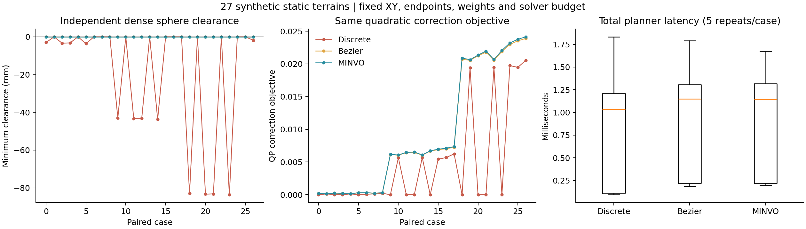
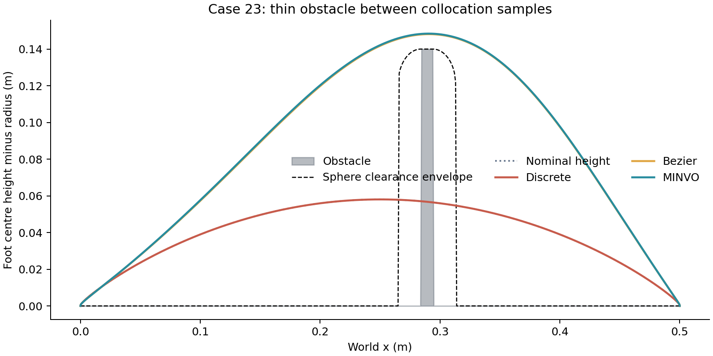
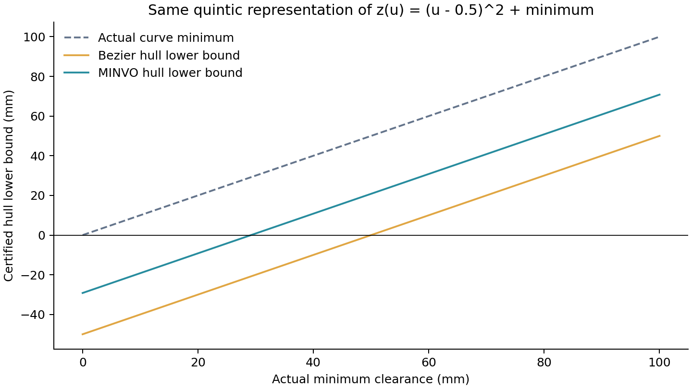

# MINVO 规划层实验与分析（2026-11-11）

> MINVO 测试现已迁入[独立 minvo_test 包](../../../test/src/minvo_test/README.md)，新的配置、源码路径和启动命令见该 README。以下保留本轮次的历史实验记录。

本次已经将 MINVO 接入生产摆动轨迹 QP，并以 §3.3 的分段几何认证独立复验。实验确认连续凸包约束能避免当前离散基线的漏检，也确认 MINVO 在指定单段曲线上能给出更紧的下界；但在本组 27 个越障 QP 中，MINVO 没有优于 Bézier，不能据此声称整体性能提升。

## 实验对象与公平性

数据由 `test/src/minvo_planning_test.cpp` 直接调用控制器中的 `PolynomialHull`、`SwingCollisionCertifier` 和 `SwingTrajectoryQpOptimizer` 生成。Python 脚本仅统计和绘图，没有另写一个优化器。此处为合成静态地形上的生产模块测试，不是 Gazebo 或实机运行数据。

- 地形组合：障碍高 0.06/0.10/0.14 m，宽 0.002/0.01/0.04 m，中心 x=0.217/0.253/0.289 m，共 27 个场景。
- 相同名义轨迹、固定 XY、起终点 `(0,0,0)` / `(0.5,0,0)`，摆动时间 0.4 s。高度坐标为球心高度减足端半径，足端半径 0.019 m。
- 五次样条 15 控制点，固定两端 p/v/a；目标权重和 qpOASES 工作集上限 200 相同。目标采样 15 点，每原始段固定细分 4 份，净空间隙峰值 0.005 m。
- Bézier/MINVO 使用完全相同的固定 XY 保守走廊；仅高度基不同，接触子段均保留 Bézier。
- 各模式各场景重复 5 次，共 405 次规划；质量指标取首次运行，耗时统计全部运行，包含参考检查与模式内部的输出复验，不包含实验外部的独立复验和密集测量。
- 离散基线明确关闭输出接受门，只用于离线暴露漏检；两个连续模式均开启输出复验。随后对所有成功输出再调用相同的独立认证器，并计算 4001 个时刻的球体净空。开启默认接受门时，离散输出也必须认证通过才能发布。

Cyberdog 的运行配置采用 60 个目标样点、0.03 m 净空，因此以下数据是对照协议的结果，不是该配置的实际运行性能。控制器与测试使用编译器 `-O3 -DNDEBUG`，耗时为当前机器观测值。

## 连续越障结果

| 指标 | 离散 QP | Bézier QP | MINVO QP |
|---|---:|---:|---:|
| 求解并输出 | 27/27 | 27/27 | 27/27 |
| 独立 §3.3 认证通过 | 14/27 | 27/27 | 27/27 |
| 密集测量发现碰撞的场景 | 13/27 | 0/27 | 0/27 |
| 最差测量净空 | −83.637 mm | 0 mm | 0 mm |
| 规划耗时中位数 | 1.035 ms | 1.148 ms | 1.146 ms |
| P95 | 1.322 ms | 1.430 ms | 1.447 ms |
| P99 | 1.354 ms | 1.488 ms | 1.599 ms |
| 最大值 | 1.834 ms | 1.790 ms | 1.674 ms |

连续模式的最小净空包含允许接触的起终点，因此 0 mm 不表示摆动中段没有抬脚间隙。密集测量用于分析，安全接受依据为独立几何认证，而非这些测量点。有限的 135 次/模式耗时观测也不是实时最坏执行时间保证。

离散模式在采样点之间会穿过窄障碍。下图按离散最差净空自动选取场景，展示地形、球体净空包络和输出；绘图没有剔除不利案例。

## MINVO 的收益与当前局限

对同一条用五次基表示的 `z(u)=(u−0.5)²+m`，生产基变换得到：

| m | 实际最小高度 | Bézier 凸包下界 | MINVO 凸包下界 |
|---|---:|---:|---:|
| 0.010 m | 10 mm | −40 mm | −19.191 mm |
| 0.040 m | 40 mm | −10 mm | 10.809 mm |

MINVO 在这一曲线族中的下界提高约 20.809 mm。对于第二行，在地面 z=0 的单段半空间约束中，MINVO 可以直接给出正下界，Bézier 需要细分或修改轨迹。这是可复现的基变换收益，不应推广为所有方向、所有曲线都更紧。

实际越障 QP 的配对结果则相反：27 个场景中，MINVO 的修正目标值均略高于 Bézier，中位数高 **0.945%**；修正高度 RMS 中位数高 **0.664%**。没有记录到目标值降低的场景。

原因是 MINVO 的凸包体积目标不等价于每个特定高度方向的下界优势，两个基产生的充分约束一般也不存在可行域包含关系。当前已有每段 4 份细分、固定 XY 地形上界及首末 Bézier 接触约束，均会影响最终收益。数据支持保留 Bézier 作为完整基线、通过开关继续对照；不支持仅凭 MINVO 名称宣称更低抬脚、更小目标或更快运行。

## 测试覆盖与边界

完整控制器编译成功；`swing_qp_regression` 与 `minvo_planning_test` 两项 CTest 通过。测试覆盖非均匀节点的精确提取、二分重构、五次基的单位和/驻点非负性、零长度域拒绝、GridMap 坐标及环形缓冲、未知栅格、窄障碍、预算耗尽返回 Unknown、必须细分的正高度谷形曲线、通过斜向分离轴排除的旁侧障碍、p/v/a 端点、工作空间冲突，以及原有缓存和地图提交顺序。

当前证书针对给定静态高程模型中的参考足端球体。IK 是采样近似；没有连续关节可达性、整腿碰撞、动态障碍、实际跟踪误差或 HOCBF 保证。保守栅格柱在坡面/台阶边的接触处可能导致计划拒绝；活动摆动沿用原缓存策略，地图更新后没有新增重认证机制。规划失败沿用异常上报，并不构成已验证的安全停车策略。

## 数据与复现

- [逐次指标（405 行）](minvo_results_2026-11-11/metrics.csv)
- [输出轨迹与地形（81081 行，按测量序列每四点存一条）](minvo_results_2026-11-11/trajectories.csv)
- [同曲线凸包下界（101 行）](minvo_results_2026-11-11/hull_bounds.csv)
- [汇总 JSON](minvo_results_2026-11-11/summary.json)
- [模块、配置与复现命令](minvo_planning_implementation.md)

后续若需要证明整套 QP 中 MINVO 的收益，应扩展曲线形状、障碍布局与细分粒度，并预先固定协议，保留没有收益和求解失败的场景；不能从当前 27 例中得出优越性结论。
