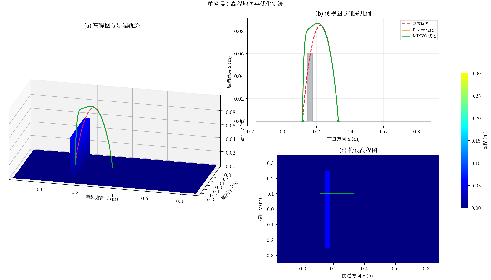
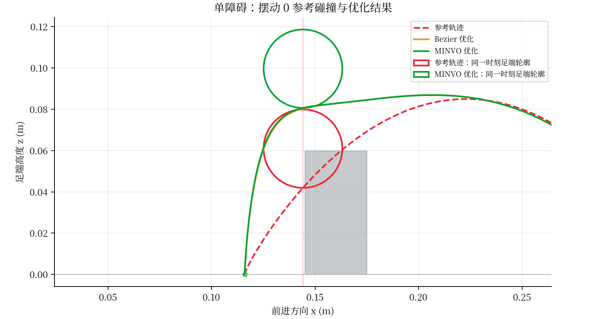
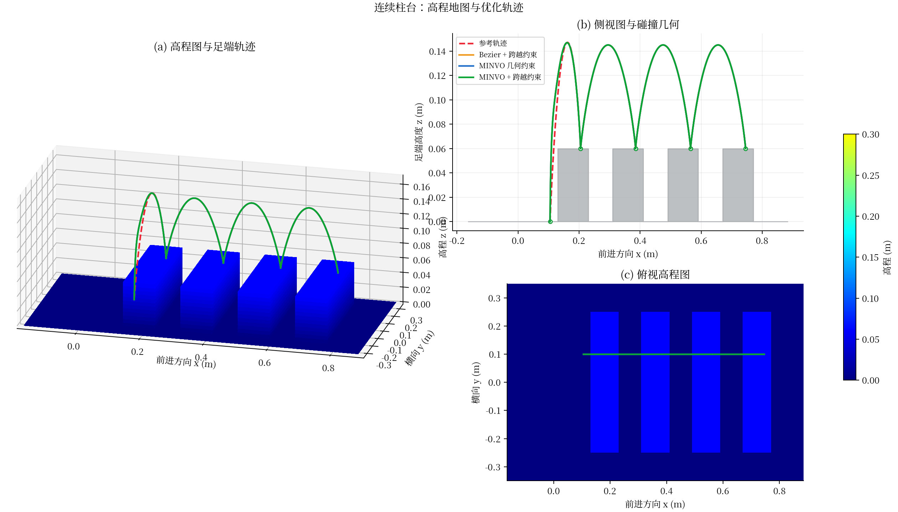
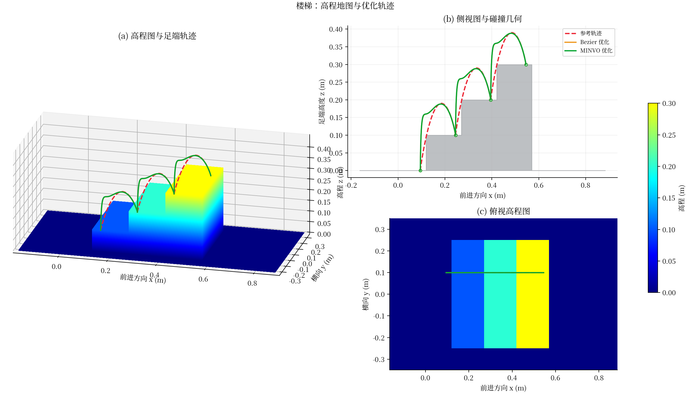
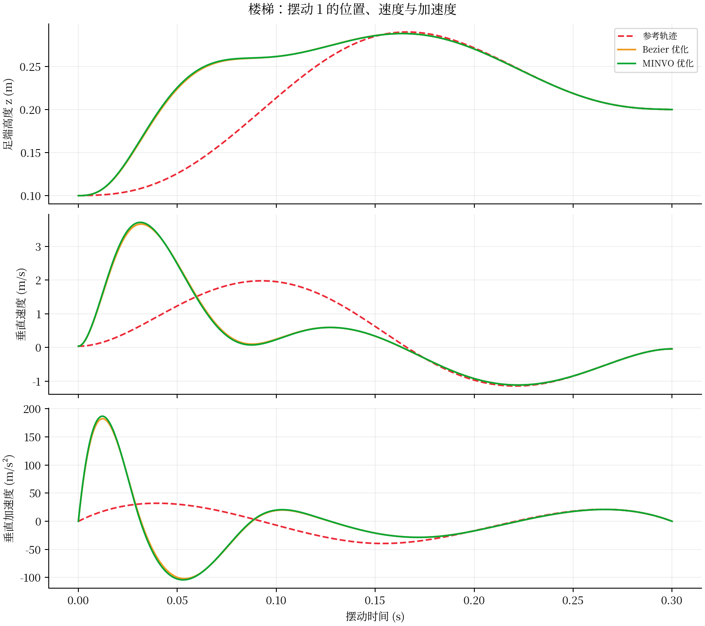
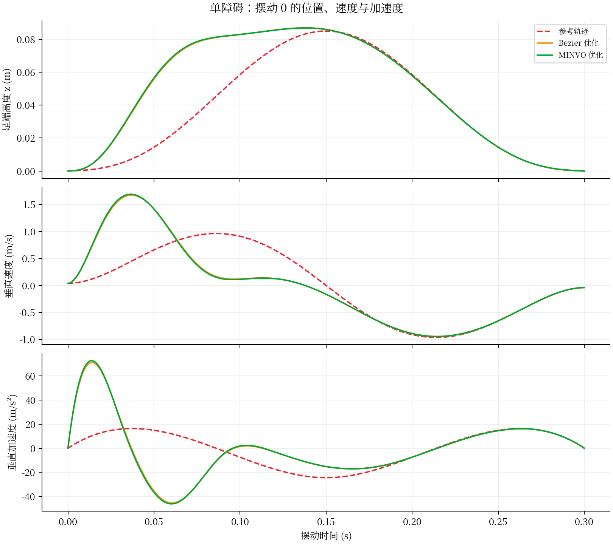
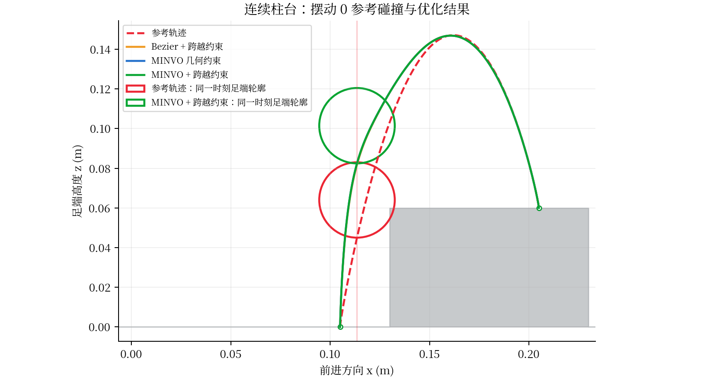
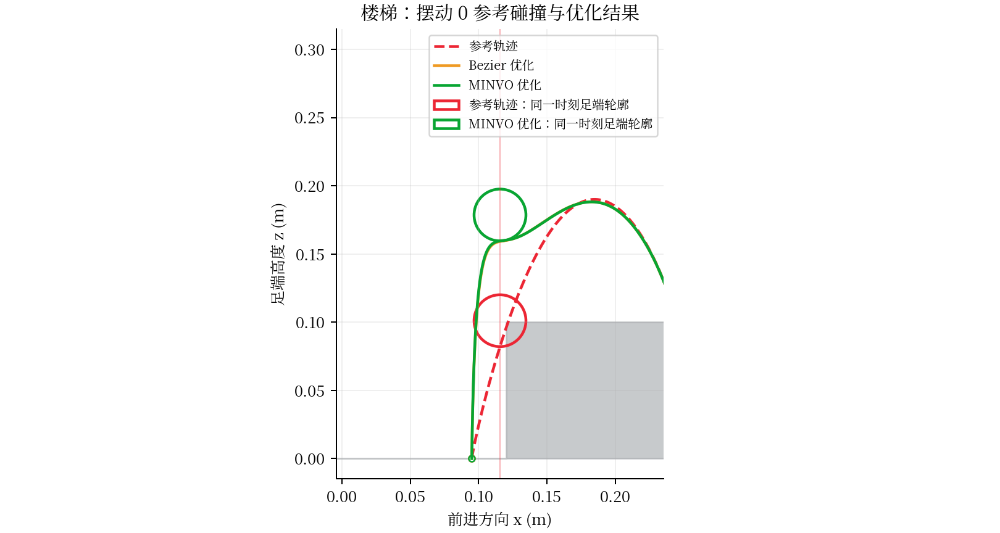
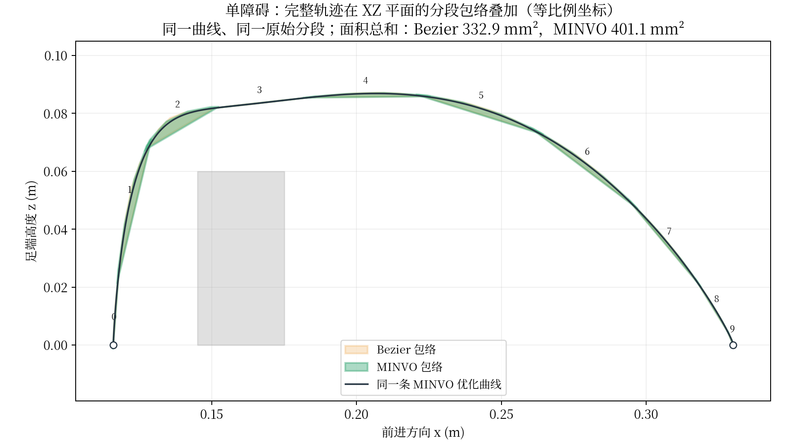
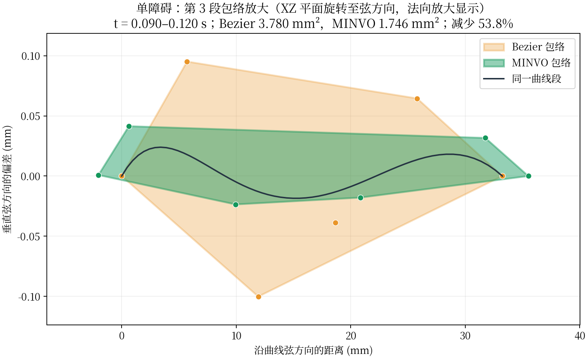

# 第5章 基于 MINVO-HOCBF 的四足机器人摆动足安全轨迹优化

## 5.1 摆动足轨迹优化问题描述

四足机器人摆动相需要使摆动足从当前支撑位置运动至下一落足位置，同时避开局部地形中的障碍。若仅把足端近似为无尺寸点，并对离散时刻的位置进行检查，则未被采样的时间区间以及足端本体的几何尺寸均可能被忽略。因此，本章将摆动足轨迹规划表述为：在满足给定起落边界条件的前提下，调整参考轨迹，使足端几何模型相对于给定地形模型满足连续时间碰撞约束。规划层采用五次 B 样条参数化轨迹，并使用 Bézier 或 MINVO 基表示分段轨迹包络；控制跟踪层的 HOCBF 方法作为后续安全接口设计讨论，不将其描述为本章已完成的控制实验。

本章实验使用静态、合成的高程地图，调用控制器代码中已有的五次 B 样条生成、MINVO/Bézier 凸包变换、二次规划和碰撞认证实现。实验验证范围是地图及足端球模型下的规划几何性质，不包含 Gazebo 行走日志、传感器融合误差、全身动力学或实机运动结果。

### 5.1.1 复杂地形下的摆动足碰撞风险分析

摆动足的碰撞风险不仅由足端参考点是否穿过障碍表面决定，还与足端的有限尺寸有关。对于本章使用的球形足端近似，足端球心高度由足端接触高度参数加球半径得到。设球半径为 $r_f$，轨迹位置参数为 $z(t)$，则球心高度为 $z(t)+r_f$。因此，参考点曲线即使没有明显穿过障碍顶面，球体仍可能与障碍物边缘相交。

图 5-1 展示单障碍场景中参考轨迹与优化轨迹的整体关系。图 5-2 对参考轨迹的足端球体与障碍边缘相交位置进行局部放大。图中的圆形截面用于表示足端球在摆动平面内的轮廓，碰撞判断仍以球体和场景几何模型为依据。该结果说明，对摆动轨迹进行安全评价时应同时纳入足端尺寸与障碍模型，而不能仅依赖足端中心点的离散高度。

### 5.1.2 摆动足轨迹优化目标与安全约束

优化目标是使输出轨迹尽可能接近名义参考轨迹，同时满足起落边界条件和规划器所采用的几何安全约束。当前实现固定水平面内的轨迹路径，主要调整五次 B 样条内部高度控制点。目标函数中的 `objective` 是参考拟合后控制点修正量对应的二次代价，不能解释为机器人能耗或全身运动代价。

安全条件由连续时间分段几何认证给出。对每个轨迹子段，规划器构造能够包围该段曲线的控制点凸包，并结合足端半径和保守地形棱柱进行分离检测。凸包与障碍相交仅表示该包围可能过于保守，不能单独作为曲线发生碰撞的结论；若无法分离，则进一步细分或返回未能证明安全的状态。输出结果还通过独立物理地图认证。因而，本章所称“安全”均限定于指定的静态地图、球形足端模型、数值容差及认证流程，不包括地图误差和轨迹跟踪偏差。

## 5.2 基于五次 B 样条的摆动足参考轨迹生成

摆动足参考曲线采用控制器中已有的五次 B 样条高度生成接口。测试代码沿用该接口确定轨迹中点高度，并将起落位置吸附到局部支撑平面；优化输出仍以五次 B 样条表示。B 样条的分段多项式结构使得每个非零节点区间都可以单独转换为 Bézier 或 MINVO 凸包，用于后续几何约束构造。

### 5.2.1 摆动足轨迹边界条件设计

每次摆动的起点和终点均由场景配置文件给出，垂直起落速度分别设为 $+0.04$ m/s 和 $-0.04$ m/s，端点加速度设为零。起落点的高度参数与支撑平面一致。配置中记录的 $z$ 表示足端球心高度减去球半径后的接触高度参数；因此在绘制足端球心或计算球体几何时，应再加一次 $r_f=0.019$ m，不能重复扣减半径。

上述边界条件用于生成和比较单次摆动轨迹。它们没有证明摆动轨迹与静止支撑相之间的速度连续，也没有包括接触冲击、足端姿态变化或关节空间约束。起落速度在接触模式切换时如何处理，需要结合步态和控制器的切换协议进一步验证。

### 5.2.2 五次 B 样条轨迹参数化

参考轨迹使用五次 B 样条和 7 个控制点；优化器使用 15 个控制点，其中首尾各 3 个控制点固定，当前配置中其余 9 个高度控制量构成主要决策变量。对于单节点内部节点，五次 B 样条具有 $C^4$ 内部连续性。该连续阶数由样条次数和节点重数决定，不依赖 Bézier 或 MINVO 表示的选择；基变换用于构造轨迹包络，不改变所表示的曲线。

### 5.2.3 摆动足参考轨迹生成与在线更新

参考中点高度沿用生产代码的摆动高度规则。令摆动时长为 $T$，抬脚高度参数为 $h_s$，时间缩放阈值为 $T_s$，则中点高度为

$$
z(T/2)=\max(z_{\mathrm{start}},z_{\mathrm{goal}})+\min(1,T/T_s)h_s.
$$

本实验使用 $h_s=0.085$ m、$T_s=0.20$ s，每次摆动时长为 $0.30$ s。单障碍参考的起落点为 $x=0.116$ m 和 $x=0.330$ m；柱台场景由地面依次落足至四个平台；楼梯场景由地面依次落足至三级踏面。各起落点可在 YAML 配置文件中修改，轨迹生成仍调用控制器已有 B 样条接口。

本节验证的是一次离线参考生成和优化流程。测试没有记录地图随时间更新、摆动中途重规划、轨迹切换或剩余摆动段的状态连续性，因此不据此声称已实现在线更新功能。

## 5.3 基于 MINVO 的连续时间地形避障约束构建

本节说明由高程地图到分段几何认证的规划流程。高度图提供二维栅格上的地形高度；测试将其构造成静态地形模型，并以半径为 19 mm 的球体近似足端。轨迹在水平投影上的路径固定，优化主要通过调节高度样条控制点实现跨越。

### 5.3.1 高程地图与足端碰撞模型

三个场景使用相同的地图栅格分辨率 5 mm，轨迹横向位置为 $y=0.10$ m，支撑平台横向范围为 $[-0.25,0.25]$ m。单障碍和柱台高度为 0.06 m；楼梯三级踏面的绝对高度为 0.10、0.20 和 0.30 m，踏面深度均为 0.15 m。机器人中心高程地图通常将环境表示为带不确定性估计的局部高程层；本章使用的则是由配置生成的静态合成高程栅格 [3]。该楼梯几何对应场景配置所引用的仿真默认 10 cm 级高模型。

图 5-1、图 5-3 和图 5-4 给出三种地形下的三维高程图、XZ 侧视图和 XY 俯视图。色标在各场景间统一为 0–0.30 m，颜色由深蓝渐变至黄色。图中垂直立面的分层颜色是依据相邻栅格高度差在绘图阶段补出的几何呈现；原始 `map.csv` 保存的是高程表面栅格，不包含立面内部的额外测量点。三维绘图为保证轨迹可见采用了轨迹优先显示方式，安全结论应结合二维侧视、数据表和连续认证状态判断。

### 5.3.2 B 样条轨迹的 MINVO 分段凸包表示

对每个五次 B 样条的非零节点区间，先提取对应的五次多项式段，再通过基变换得到表示该段曲线的控制点。若基函数在区间内非负且权重和为 1，则曲线上任一点均为相应控制点的凸组合，整段曲线因此包含于控制点凸包中。将 Bézier 或 MINVO 控制点凸包用于碰撞约束，可以把连续时间曲线检查转化为分段凸几何检查。MINVO 基的研究目标是为给定多项式曲线构造较紧的包围单纯形；既有论文中的特定阶数和空间维度结果并不直接等价于本章的五次轨迹 XZ 投影面积结果 [1]。

图 5-9 对同一条单障碍 MINVO 优化轨迹的全部原始多项式段进行 XZ 投影包络对比。每个分段分别绘制其 Bézier 与 MINVO 凸包，因此图中展示的是沿整条轨迹的局部包络集合，而不是一个包围整条曲线的整体凸包。全部分段面积相加时，分段之间的重叠区域会重复计入。当前 Bézier 面积和约为 332.93 mm²，MINVO 面积和约为 401.13 mm²；在该定义下，MINVO 面积和比 Bézier 大约 20.5%。因此，完整轨迹图不支持“MINVO 在所有分段或整个轨迹上均具有更小投影包络”的结论。

图 5-10 展示面积比最小的第 3 段，时间范围为 0.09–0.12 s。该段 Bézier 和 MINVO XZ 投影面积约为 3.780 mm² 和 1.746 mm²，局部减少约 53.8%。绘图将坐标旋转至段端点连线的弦方向，并放大法向偏差，旋转保持真实面积不变，非等比例显示仅用于突出狭长包络的差异。该分段是从候选轨迹中筛选得到的最佳局部案例，不能作为所有曲线上的普遍性能结论。

上述两张包络图在 5.7.5 节统一列出。

### 5.3.3 基于地形安全走廊的连续时间避障约束

对于一段轨迹，若其足端包络经过足端半径膨胀后与保守地形模型分离，则可在指定地图和几何假设下得到该段的连续时间安全证书。当前实现对控制点施加分段凸包避障条件，并将输出交由独立物理地图认证器再次检查。QP 每个原始节点区间采用 4 个固定分片；认证阶段可对尚未能分离的几何段进行自适应细分。固定分片用于优化约束构造，自适应细分用于安全认证，两者作用不同。

柱台场景还设置了三段虚拟跨越带，分别位于相邻平台之间，要求规划轨迹在这些区域满足设定的最低高度策略。虚拟带只用于规划策略，不改变物理高程图中的实际间隙。Bezier 与 MINVO 方法使用相同跨越带策略；另有不采用虚拟跨越带的 `MINVO_geometry` 结果用于区分几何避障与该高度策略。当前结果中几何组也未下探至柱顶以下，因此不能据此证明跨越带策略相较几何组带来了额外的性能收益。

### 5.3.4 面向复杂地形的自适应分段与约束优化

自适应细分用于处理凸包较松或障碍关系无法直接判定的子段：将时间区间进一步切分后重新构造局部包络并重复分离检查。若达到算法允许的细分条件后仍不能证明安全，则应保留未知或失败状态，而不能把“采样没有碰撞”替代为连续时间安全证书。

本章实现中，自适应细分属于认证流程的一部分；QP 本身仍按固定分片数构造约束。本批实验没有对不同 QP 分片数、自适应 QP 决策变量数量或不同细分策略进行系统扫描，因此本节仅说明当前实现的模块关系，不对“自适应优化优于固定优化”作实验判断。

## 5.4 基于二次规划的摆动足轨迹优化

### 5.4.1 优化决策变量与目标函数设计

优化器以 15 个控制点描述五次高度样条，首尾各 3 个控制点固定以保持边界条件，内部高度控制点用于调整参考轨迹。当前水平位置路径固定，因此决策主要发生在竖直方向。目标函数惩罚拟合后控制点相对于参考控制点的修正量，使输出在满足安全约束的同时尽量接近参考曲线。具体权重和边界条件以随数据导出的场景配置快照为准。

### 5.4.2 连续时间避障约束与运动学约束

起终点位置、垂直速度和端点加速度按场景设置；避障约束来自各分段控制点包络与地形模型的几何关系。当前规划优化未启用经过系统验证的机器人全身 IK、关节限位约束，也没有施加并验证足端速度和加速度硬上限。因而，轨迹在数学上连续并不等价于轨迹满足机器人可执行的动态范围。

图 5-5 给出楼梯场景中摆动轨迹的高度、垂直速度和垂直加速度曲线。样条内部节点的两侧解析检查显示位置、速度和加速度连续；样条的内部连续阶数为 $C^4$。楼梯轨迹的三维速度采样峰值约为 3.715 m/s，加速度采样峰值约为 186.986 m/s²。此处曲线图绘制的是竖直分量，峰值表中的数值则是三维速度、加速度范数；两者不可直接逐值比较。楼梯加速度峰值较大，说明仅凭连续性检查不能认定轨迹可直接由机器人执行。

### 5.4.3 轨迹优化问题的可行性分析

本批三个场景共输出 20 条优化轨迹：单障碍场景 2 条，柱台场景 12 条，楼梯场景 6 条。它们均通过独立物理地图的连续时间几何认证，起终点误差小于 $10^{-8}$ m。参考轨迹在三个场景中均存在负的保守竖直净空；单障碍、柱台首段和楼梯场景还记录到名义实体障碍与参考足端球相交的采样见证。认证状态 `Unknown` 不应解释为安全；碰撞见证与高程网格保守净空的数值也代表不同指标。

这些结果说明所选配置下求解器得到有效输出，不代表任意地形或任意起落位置均有可行解。本批数据没有系统统计失败率、不可行原因或不同障碍几何下的成功概率。

### 5.4.4 QP 求解与优化轨迹生成

优化器输出的轨迹通过生产样条接口计算位置、速度与加速度，并完成物理地图认证。数据中的 `planning_ms` 是一次 `optimizeSwingTrajectory` 调用的总耗时，包含拟合、内部碰撞检查、QP 与内部输出认证等步骤；不包含文件导出、绘图以及调用后的独立复认证。单障碍样例耗时约为 0.96–1.18 ms，楼梯样例约为 46.9–49.1 ms。柱台首段约为 30.9–31.2 ms，其余摆动约为 0.91–0.97 ms。该差异与各次求解涉及的几何约束和处理流程相关，但当前结果并未提供分项耗时以进一步归因。

上述时间来自单次运行记录，不是重复试验的统计量，也没有 P95/P99、固定频率截止期或目标硬件上的实时性测试，因此只能作为当前测试程序的一次规划调用耗时记录。

## 5.5 基于高阶控制障碍函数的摆动足安全跟踪

本节给出 HOCBF 跟踪层的理论接口设计，目的是说明规划几何约束如何与闭环跟踪安全层衔接。高阶控制障碍函数针对具有相对阶的安全约束构造控制条件 [2]。但当前测试包没有接入 HOCBF-QP、安全滤波控制输出或跟踪误差仿真，因此本节公式代表待验证的设计，不是本章实验结果。

### 5.5.1 摆动足跟踪动力学模型与安全函数构建

作为任务空间的简化设计，可将足端状态写成 $\dot p=v$、$\dot v=u+w$，其中 $u$ 为期望足端加速度，$w$ 表示未建模误差或扰动。可基于局部保守地形高度上界构造足端净空安全函数；若用 $H_c(x,y)$ 表示该上界，则非接触摆动阶段的安全余量可写为

$$
h(p)=z-H_c(x,y)-r_f-d_s,
$$

其中 $d_s$ 为设计净空。高度图的不可用区域、垂直立面及多层结构需要另行建模，不能未经验证地直接对离散高程计算导数并用于 HOCBF。足端加速度命令也必须能够通过现有控制接口稳定实现，才能将任务空间分析与关节或全身控制联系起来。

### 5.5.2 高阶控制障碍函数约束设计

当安全函数对控制输入的相对阶为二时，可定义 $\psi_0=h$、$\psi_1=\dot h+\alpha_1h$，并要求

$$
\ddot h+(\alpha_1+\alpha_2)\dot h+\alpha_1\alpha_2h\ge 0,
$$

其中 $\alpha_1,\alpha_2>0$。该约束在系统模型、地形函数正则性、初始安全条件以及输入可行性等假设成立时才具有相应安全含义 [2]。针对楼梯立面和狭窄通道，采用局部安全走廊平面构造屏障也是一种候选设计。具体屏障选择及其对当前四足控制输入的映射尚未在本实验中实现和验证。

### 5.5.3 基于 HOCBF-QP 的安全跟踪控制

拟议的接口是在名义足端跟踪指令之外，增加一个以当前足端状态、参考状态和有效安全集合为输入的安全过滤层。过滤层通过 QP 在安全不等式和控制输入可行域内寻找与名义指令偏差较小的控制命令；当约束不可行时，应向上层报告不可行状态并由轨迹或步态模块处理。已有 HOCBF 理论给出控制屏障条件的构造基础 [2]，但其在本控制器中的实时求解、命令转换、不可行恢复和安全效果都需要独立实验。

### 5.5.4 MINVO 规划与 HOCBF 跟踪的安全一致性分析

规划层连续几何证书说明名义参考轨迹相对于地图模型满足指定几何条件；HOCBF 层若实现，则约束实际足端状态在动力学模型下的演化。前者不能自动推出带跟踪误差的闭环安全，后者也不能替代规划器对落足位置和摆动轨迹的选择。后续需要统一地图版本、足端误差界、轨迹时间区间和控制可行域，并分别验证规划证书、闭环跟踪误差以及安全过滤器的干预与不可行率。

## 5.6 摆动足轨迹在线重规划与全身控制协调

当前实现通过离线单段轨迹优化及独立几何认证完成规划验证，没有实现或测量摆动中途的在线重规划触发、剩余轨迹连续切换及恢复策略。因此，本节给出和控制框架衔接时需要解决的设计问题，不报告在线重规划实验结果。

### 5.6.1 基于碰撞风险的在线重规划触发机制

在线系统可依据地图更新后的轨迹证书状态决定是否重新优化：若当前剩余轨迹仍能在新地图下被认证，可继续执行；若出现碰撞风险或认证未知，则需触发重规划或进入上层安全处理。此流程需使用带版本信息的地图快照，并在新轨迹提交前对最新地图重新验证。当前离线数据未记录地图更新、触发次数或触发延迟。

### 5.6.2 剩余摆动轨迹的连续性与终端约束

执行中重规划的初始条件应与当前足端实测状态相容，至少需要处理位置和速度连续，并根据控制切换协议决定是否约束加速度。终端条件需保持落足位置和接触速度要求。当前样条内部节点 $C^4$ 连续的结果只针对单次静态规划输出，不能代替新旧轨迹拼接连续性的测试。

### 5.6.3 在线优化可行性与安全恢复策略

当优化无解或认证返回未知时，系统应区分不可行、已发现碰撞和未能证明安全等状态，避免将未知结果当作安全轨迹发布。后续恢复策略需与步态调整和支撑腿可行性协调。本批实验只记录有效规划样例，没有闭环恢复数据或规划失败率统计。

### 5.6.4 优化轨迹与 NMPC-WBC 控制框架的集成

控制集成时，规划模块输出应包含轨迹状态、有效时间区间、参考地图版本和几何证书信息；跟踪控制器则需给出轨迹执行误差和可实现性反馈。MINVO 规划与 HOCBF 安全跟踪的职责不同，需要通过明确接口传递状态和安全条件。当前测试程序直接调用控制器生产规划模块，不等同于已经完成 NMPC-WBC 闭环集成。

## 5.7 仿真实验与结果分析

### 5.7.1 实验环境与评价指标

本节结果来自 minvo_test 独立测试包生成的静态合成高程场景。轨迹生成、优化和认证调用控制器中的生产实现。实验配置包含一个 60 mm 高单障碍、四个 60 mm 高柱台以及三级楼梯。单障碍轨迹起点至终点为 0.116–0.330 m；柱台依次落足于四个平台；楼梯踏面深度为 0.15 m、级高为 0.10 m。地图分辨率为 5 mm，足端球半径为 19 mm，单次摆动时长为 0.30 s。

评价量包括：参考轨迹保守竖直净空、独立连续几何认证状态、端点误差、内部节点连续性、三维速度与加速度采样峰值、控制点修正二次代价，以及单次规划调用耗时。安全认证与密集采样指标分开报告；连续时间安全结论依赖认证器，不由无碰撞采样单独推出。包络面积以同一曲线和相同原始分段的 XZ 投影比较，面积和不是各包络并集面积。

**表 5-1 场景配置与轨迹数量**

| 场景 | 障碍/地形参数 | 摆动数 | 优化输出数 |
|---|---|---:|---:|
| 单障碍 | 障碍高 0.06 m，纵向厚度 0.03 m | 1 | 2 |
| 连续柱台 | 4 个柱台，高 0.06 m，柱间净间隙 0.08 m | 4 | 12 |
| 楼梯 | 3 级，级高 0.10 m，踏面深 0.15 m | 3 | 6 |

优化输出数按每个摆动对应的优化方法结果计数，并非独立地形试验次数。单障碍和楼梯各有 Bézier 与 MINVO 两类结果；柱台另含不使用虚拟跨越带的 `MINVO_geometry` 结果。

### 5.7.2 不同高度单障碍物下的轨迹优化实验

当前单障碍场景的障碍高度固定为 0.06 m，因此实验仅能分析该高度下的一个轨迹案例，不能据此比较不同障碍高度的变化规律。参考轨迹的最小保守竖直净空为 $-32.269$ mm，名义实体障碍与参考足端球的采样碰撞见证裕度为 $-17.746$ mm。两项指标分别基于高程保守裕度和球体—方柱距离计算，数值定义不同，不应直接互换。

Bezier 和 MINVO 优化输出均通过独立物理地图认证，端点误差低于 $10^{-8}$ m。结果表明，在该地图与足端模型下，规划器能够把发生碰撞风险的参考摆动修正为通过连续时间几何认证的轨迹。该结论限于当前一个障碍高度和起落点配置。若要支撑“不同高度”比较，需在其余参数固定时增加高度扫描，并重新生成全部数据和图表。

### 5.7.3 连续障碍物下的跨越安全性实验

柱台场景包含四个高度为 0.06 m 的平台，平台之间的物理间隙为 0.08 m。摆动足依次由地面落至四个平台，柱顶落足点距平台后缘 25 mm。第一段参考轨迹的保守竖直净空为 $-21.801$ mm，并具有名义球体碰撞采样见证；后续三段参考轨迹在该配置下未显示负保守净空。全部 12 条优化输出通过物理地图连续认证。

相邻柱体之间另设置虚拟最低高度带，以编码跨越柱顶高度的规划策略，而物理地图中的狭缝仍保持真实几何。该实验说明优化曲线在当前策略和配置下未落入设定的虚拟低高度狭缝区域；但 `MINVO_geometry` 结果同样没有下探到柱顶以下，因此不能声称该虚拟策略在本组结果中单独提高了安全性或可行性。

图 5-3 已给出连续柱台场景的全局轨迹，图 5-7 展示首段参考碰撞及优化局部结果。

### 5.7.4 楼梯地形下的摆动足轨迹优化实验

楼梯场景使用 0.10 m 级高和 0.15 m 踏面，摆动足从地面依次落至三级踏面。原始参考轨迹的最小保守竖直净空为 $-65.292$ mm，名义实体障碍与参考球体的碰撞见证裕度为 $-14.523$ mm。六条优化输出均通过独立物理地图连续认证，端点误差小于 $10^{-8}$ m。

样条连续性检查显示内部节点处位置、速度和加速度差分别约为 $2.23\times10^{-9}$ m、$5.82\times10^{-8}$ m/s 和 $6.93\times10^{-6}$ m/s²，且内部最小连续阶数为 $C^4$。但楼梯案例的三维速度与加速度采样峰值分别约为 3.715 m/s 和 186.986 m/s²。此结果揭示了几何避障与动态可执行性之间的差别：本次优化满足当前端点条件并通过几何认证，但没有设置足端动态硬上限，因此不能据此确认其适用于实际机器人执行。

图 5-4 已给出楼梯场景全局轨迹，图 5-8 展示局部避障结果。

### 5.7.5 MINVO 凸包约束与轨迹优化消融实验

本节分开讨论两种比较。第一种是在同一条 MINVO 优化输出曲线上，将相同原始分段分别转换为 Bézier 与 MINVO 表示，以比较基变换的包络差异；第二种是分别采用 Bézier 或 MINVO 约束重新求解，以比较优化结果。两种比较回答的问题不同，不能将不同轨迹之间的差异当成同曲线包络紧致性。

在同一曲线的完整 XZ 投影分段面积和比较中，MINVO 面积和约为 401.13 mm²，Bezier 面积和约为 332.93 mm²，当前曲线下 MINVO 总和高约 20.5%。在筛选出的第 3 段中，MINVO 面积约为 1.746 mm²，Bezier 约为 3.780 mm²，局部面积减少约 53.8%。因此，MINVO 在该案例中呈现局部包络优势，但没有呈现完整轨迹面积和上的优势。局部分段是经候选搜索后按面积比选择，属于有选择的可视化案例，不是无偏统计样本。

从独立规划结果看，Bezier 与 MINVO 在三个场景选定配置下均得到有效并通过认证的轨迹。当前数据没有完整的离散采样约束对照、分片数扫描、多次独立重复和规划失败率统计，因此只能作为初步规划方法比较，不能据此概括 MINVO 对所有环境的求解成功率或计算性能优势。

### 5.7.6 HOCBF 安全跟踪与在线计算性能分析

当前数据不包含 HOCBF 控制输入、跟踪误差、干预量、闭环碰撞率、QP 不可行率或在线重规划触发日志，因此无法分析 HOCBF 安全跟踪效果或在线重规划性能。现阶段能够报告的计算量只有规划调用耗时：其为单次计时，且包含拟合、内部碰撞检查、QP 以及内部输出认证，不是纯 QP 求解耗时。单障碍与楼梯样例的调用时间差异明显，但没有分项计时和重复统计，不能解释为稳健的实时性能结论。

## 5.8 本章小结

本章基于控制器中已有的五次 B 样条轨迹生成、Bézier/MINVO 分段凸包变换、QP 优化和连续时间几何认证实现，构建了单障碍、连续柱台和楼梯三类静态高程场景。对于当前配置，20 条优化输出均通过独立物理地图连续认证，起落端点误差小于 $10^{-8}$ m，样条内部位置、速度和加速度保持连续。

同曲线包络比较显示，MINVO 在筛选出的单障碍第 3 段中相较 Bézier 减少约 53.8% 的 XZ 投影面积，但全轨迹分段面积和增加约 20.5%，因而本组数据只支持局部优势结论。楼梯轨迹虽通过几何安全认证并保持内部连续，速度和加速度采样峰值仍较高，尚不能确认其满足机器人执行限制。当前实验也未覆盖不同高度扫描、HOCBF 跟踪闭环、在线剩余轨迹重规划或 NMPC-WBC 集成；这些内容需要在后续实现和实验中验证。

## 参考文献

[1] J. Tordesillas and J. P. How, “MINVO Basis: Finding Simplexes with Minimum Volume Enclosing Polynomial Curves,” *Computer-Aided Design*, vol. 151, article 103341, 2022. DOI: [10.1016/j.cad.2022.103341](https://doi.org/10.1016/j.cad.2022.103341).

[2] W. Xiao and C. Belta, “High-Order Control Barrier Functions,” *IEEE Transactions on Automatic Control*, vol. 67, no. 7, pp. 3655–3662, 2022. DOI: [10.1109/TAC.2021.3105491](https://doi.org/10.1109/TAC.2021.3105491).

[3] P. Fankhauser, M. Bloesch, C. Gehring, M. Hutter, and R. Siegwart, “Robot-Centric Elevation Mapping with Uncertainty Estimates,” in *Mobile Service Robotics*, pp. 433–440, World Scientific, 2014. DOI: [10.1142/9789814623353_0051](https://doi.org/10.1142/9789814623353_0051).

